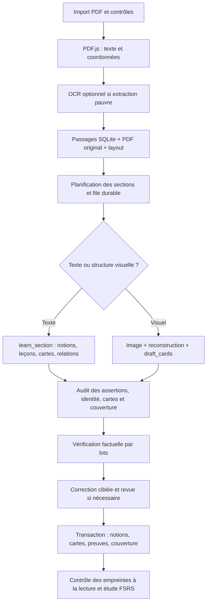

> Historical implementation report, before the teacher-course reform. For the current product and generation contract, read [PRODUCT.md](../PRODUCT.md) and [teacher-course-architecture.md](teacher-course-architecture.md). Source-only restrictions in this report do not apply to the current production pipeline.

# MORROW — audit architectural et corrections

Audit du 10 octobre 2026. Le diagnostic a été présenté avant modification. Les corrections ci-dessous ont ensuite été appliquées conformément à la demande. Les observations historiques ne constituent pas une évaluation du nouveau code.

**Suite de l'audit :** le parcours textuel a depuis été modifié pour ne plus générer de leçons lors de l'import par défaut. Voir [la décision source-first](morrow-source-first-architecture-decision.md). Les descriptions ci-dessous des leçons obligatoires décrivent le diagnostic initial et le mode riche conservé en option, pas le nouveau défaut `sections-v9`.

## Diagnostic principal

Le problème ne se réduit pas à la rédaction des prompts. MORROW demande encore, pendant l'importation, des notions, des explications pédagogiques riches, des expériences et des relations, puis vérifie cet ensemble avant publication. Cette charge augmente la latence et donne au générateur davantage d'occasions d'extrapoler un document pauvre. Certaines validations et déduplications avaient également des défauts techniques. Renforcer les instructions ne peut restituer une structure de tableau perdue ni corriger ces défauts.

L'exactitude scientifique et la pertinence pédagogique actuelles n'ont pas de note mesurée : les tests automatiques utilisent principalement des modèles simulés. Le statut `ready` signifie que les contrôles programmés ont accepté la carte, pas qu'un spécialiste garantit sa vérité.

## Modèle et configuration réellement chargés

Configuration locale inspectée avec le chargement d'environnement de Next.js, sans exposer de secret :

| Paramètre | Valeur effective |
|---|---|
| Fournisseur | OpenAI, sélection automatique par présence de sa clé |
| Générateur | `gpt-4o` via `OPENAI_MODEL` |
| Auditeur principal | `gpt-4o`, faute de modèle d'audit distinct |
| Vérificateur factuel | `gpt-4o`, faute de modèle d'exactitude distinct |
| API structurée | Chat Completions, appel de fonction imposé, schémas stricts pour les étapes principales |
| Temperature / top_p / seed | Non spécifiés par le code ; aucune garantie de déterminisme |
| Timeout cloud / retries SDK | 60 secondes par appel / zéro reprise automatique SDK |
| Pipeline | `progressive` par défaut |
| Sections distantes simultanées | 3 par défaut, réglables de 1 à 4 |
| OCR local | Non configuré |
| Budget documentaire | 120 requêtes et 500 000 tokens ; appels déjà actifs susceptibles de dépasser le seuil de tokens |
| Exécution | Inline en développement par défaut ; worker supervisé avec `npm start` |

Fichiers : `lib/llm.ts`, `lib/generationPolicy.ts`, `lib/generationLimits.ts`, `lib/llmTelemetry.ts`, `scripts/start.mjs`. Le modèle de secours dans le code est `gpt-4o-mini`, **ce n'est pas le modèle sélectionné dans cet environnement**. L'alias ne permettait pas de connaître le snapshot effectivement servi dans les anciens journaux. Les nouveaux journaux enregistrent aussi le modèle retourné par OpenAI/Anthropic.

## Pipeline complet

1. **Import** — `app/api/documents/route.ts` contrôle formulaire, taille, signature et erreurs PDF ; extrait les pages, crée les passages et conserve le fichier original et le layout. Nettoyage compensatoire en cas d'échec.
2. **Extraction** — `lib/pdf.ts` garde le texte PDF dans l'ordre des items, ainsi que les coordonnées dans `lib/pdfLayout.ts`. Jusqu'à quatre extractions simultanées. OCR conditionnel si moins de 80 caractères, uniquement avec un binaire configuré. Caches d'extraction et d'images bornés. L'ordre des items PDF ne garantit pas l'ordre de lecture de plusieurs colonnes.
3. **Planification** — `lib/sectionPlanning.ts` : première section textuelle limitée à deux pages/3 500 caractères, suivantes à six pages/9 000 caractères ; pages visuelles isolées. Les critères sont heuristiques.
4. **Orchestration** — `lib/documentGeneration.ts` gère les jobs SQLite, les claims, les heartbeats, les budgets partagés et les reprises. `lib/generationDispatch.ts` unifie maintenant le chemin foreground et le worker.
5. **Génération textuelle** — `lib/sectionGeneration.ts` sélectionne les sources primaires et deux pages de référence lexicalement pertinentes. `sourceCatalog` garde les extraits complets avec identifiants vérifiables. Un appel produit jusqu'à 12 notions, leurs leçons, 36 cartes et 16 relations. Une carte cite ses propres extraits ; elle ne doit pas hériter automatiquement de toute la preuve de sa notion.
6. **Chemin visuel/ancien** — `lib/generateSlides.ts` et `lib/courseSections.ts` : plan de cours, inventaire en mode détaillé, reconstruction pédagogique, conception des cartes directement depuis les sources, audit global, vérification factuelle, éventuelle réparation. Le mode rapide retire certaines étapes mais conserve la reconstruction. Il peut encore coûter de nombreux appels pour une seule page.
7. **Validation et publication** — citations résolues côté serveur, assertions contrôlées, vérification factuelle dans `lib/accuracyAudit.ts`, contrôles de calcul/portée, correction ciblée bornée. Écritures transactionnelles, empreintes des sources et contrôles de course/claim évitent les publications après remplacement du document.
8. **Après import** — `lib/qaGeneration.ts` génère des Q&A pour une notion à partir de ses pages et de voisins ; `lib/conceptLesson.ts` approfondit une leçon à la demande. Ces chemins disposent de revues propres. Les identités de cartes et l'historique FSRS sont protégés lors du remplacement d'un brouillon automatique.

## Preuves historiques de mauvaise qualité et de lenteur

Dans la base locale, le dernier job du document de 38 pages `Session_1_Introduction` était en échec : **53 requêtes, 318 193 tokens d'entrée, 68 246 de sortie, environ 4 min 27 s, trois cartes créées et zéro carte prête**. Il utilisait une version historique `slides-v15`, pas les corrections actuelles. Une exécution de la page 29 comportait **15 appels et environ 3 min 12 s**.

Les sorties/rejets historiques contiennent notamment des extrapolations sur la part de marché et la confiance. Les trois cartes enregistrées citent la page 24, une publicité Liberty Mutual avec la Statue de la Liberté. L'une transforme une expérience hypothétique sur l'imagerie nationale en résultat affirmé d'augmentation de confiance. L'image n'établit pas ce résultat. Ces cartes restent des brouillons ; les validations ont empêché leur mise en étude, mais n'ont pas produit de bonnes cartes de remplacement. Une page de tableau avait également renvoyé un ensemble vide de notions/cartes.

## Problèmes classés, impact et correction

`Démontré` désigne un comportement lisible dans le code ou une sortie historique observée. Il ne signifie pas que sa fréquence est mesurée.

| Priorité | Fichier(s), cause technique | Impact probable | Correction et état |
|---|---|---|---|
| P0 — démontré | `sectionGeneration.ts`, `generateSlides.ts` : publication des cartes dépendait trop de l'acceptation de l'explication complète de la notion | Une bonne carte pouvait être perdue à cause d'une analogie ou d'un développement invalide | **Corrigé** : identité label/définition contrôlée séparément par les deux revues ; carte vérifiée indépendamment ; notion minimale autorisée sans explication rejetée. La leçon reste signalée comme incomplète. |
| P0 — démontré | `generateSlides.ts` : revue factuelle de carte utilisant des preuves de la notion au lieu de sa sélection propre | Revue plus large que les citations réellement publiées, pouvant masquer une carte insuffisamment justifiée | **Corrigé** : revue avec les preuves propres de la carte. |
| P0 — démontré | `contentQuality.ts`, `qaGeneration.ts` : normalisation supprimant opérateurs, exposants et distinctions de symboles | Faux doublons ; fusion de cartes distinctes et possible remplacement d'un objectif différent | **Corrigé** : égalité et nouveaux identifiants de Q&A préservent signes, exposants, unités et casse ; seul l'espace est normalisé. Aucun identifiant existant n'est migré. Paraphrases confiées à la décision explicite de revue. |
| P0 — démontré | `pdf.ts` : normalisation supprimant les retours de ligne ; `pdfLayout.ts` : tableaux/formules détectés mais non routés vers l'image | Perte des lignes, colonnes, conditions et sens de formules ; génération hors sujet | **Partiellement corrigé** : nouveaux passages conservent les lignes/paragraphes ; structures détectées imposent la revue visuelle, même avec ancien layout stocké. Les anciens passages ne sont pas réextraits automatiquement. La détection des tableaux reste heuristique. |
| P1 — démontré | Route `/generate` choisissait `generateSlides`, worker choisissait `sectionGeneration` | Comportement différent selon le bouton/chemin, optimisations non appliquées partout | **Corrigé** par dispatch partagé et test de la vraie route foreground. |
| P1 — démontré | `accuracyAudit.ts` : lots factuels séquentiels ; entrées contenant aussi des copies redondantes de candidats/leçons | Attente et tokens inutiles, surtout avec plusieurs notions par section | **Corrigé** : deux lots indépendants simultanés par section par défaut, plafond configurable 1–3 ; suppression des copies redondantes dans les revues principales. Les lots déjà partis sont attendus avant retour d'erreur. Pas de suppression de validation. |
| P1 — démontré | `teachingPolicy.ts` exigeait au moins un pont explicatif, même quand une liste vide était valide dans le schéma | Pression à fabriquer une déduction ou du contexte ; échec sans nécessité | **Corrigé** : liste vide permise ; tout pont fourni garde les vérifications de prémisses. |
| P1 — démontré | `sectionGeneration.ts`, `intuitivePedagogy.ts` : expérience, mécanisme et leçon riche restent obligatoires dans la génération initiale | Sortie longue, attente avant premières cartes ; extrapolations sur une source seulement descriptive | **Reste à découpler** : comparer un chemin notions minimales + cartes puis approfondissement à la demande. La publication est découplée, mais le coût de génération de leçon ne l'est pas encore. Changement à mesurer avant généralisation. |
| P1 — démontré | `generationPolicy.ts`, `coursePedagogy.ts`, `qaGeneration.ts` : sélection lexicale et plafonds de références ; résumé global omettant le milieu de pages longues | Définitions préalables ou conditions absentes ; mauvaise interprétation d'une rubrique isolée | **Reste à améliorer** : tester des cas annotés puis récupération structurée par section, références et layout. Les sources primaires du chemin progressif ne sont pas arbitrairement tronquées par `sourceCatalog`. |
| P1 — configuration démontrée, effet hypothétique | `llm.ts` : générateur et deux critiques utilisent `gpt-4o` | Erreurs corrélées possibles ; trois appels ne constituent pas trois preuves indépendantes | Comparer sur le même corpus un autre modèle de revue et une référence humaine. Ne pas changer aveuglément le modèle ni prétendre qu'un modèle plus cher résout le problème. |
| P2 — démontré | `contentReview.ts` : absence d'empreinte de revue d'une ancienne leçon ne produit pas d'alerte à elle seule | Ancienne explication peut être affichée sans les garanties des nouvelles publications | Prévoir qualification explicite des leçons anciennes et revue/régénération ciblée, en protégeant les modifications utilisateur. Pas de certification ou migration silencieuse des anciens contenus ici. |
| P2 — démontré | `llmTelemetry.ts`, `accuracyAudit.ts` : seuil de tokens vérifié avant appels, comptage après réponses ; limite des lots porte sur le texte généré, pas toute l'entrée | Dépassement possible par appels simultanés et sources répétées ; coût variable | Traces par outil ajoutées pour OpenAI/Anthropic ; mesurer puis limiter l'entrée et la concurrence globale si nécessaire. Avec 3 sections × 2 revues, jusqu'à 6 appels factuels peuvent être actifs. Budget de tokens n'est pas un plafond financier strict. |
| P2 — démontré | Tests de génération avec réponses simulées ; absence de notes humaines complétées | Les tests peuvent réussir malgré des cartes médiocres produites par le modèle réel | Garder les tests de sécurité/comportement, ajouter évaluation réelle annotée : fidélité, utilité, atomicité, autosuffisance, omissions, première carte et durée/coût total. |

## Ce que la comparaison avec RemNote permet réellement de conclure

La documentation publique de [génération RemNote](https://help.remnote.com/en/articles/10102901-generating-flashcards-with-ai) décrit sélection des idées importantes, aperçu/modification des cartes, traitement d'images et réutilisation d'une génération pour un texte et des réglages identiques. Elle présente les cartes comme un point de départ à vérifier. Elle ne publie pas une garantie d'exactitude de 100 % ni l'architecture interne complète.

Le [Guided Learn Mode](https://help.remnote.com/en/articles/15724936-guided-learn-mode) documente un travail progressif sur les sections d'une source, avec résumés, cartes, quiz et retour utilisateur. La séparation des usages et le maintien de la source visible sont pertinents pour MORROW. **L'inférence architecturale** est qu'imposer toute une leçon riche avant de fournir des cartes ajoute une charge que la simple conception de cartes n'exige pas. Nous ne connaissons pas les prompts privés, le modèle exact ou le nombre d'appels internes de RemNote ; aucune parité n'a été mesurée.

## Validation et limites

Vérifications exécutées : `npm test` (suite complète), `npm run lint`, `npx tsc --noEmit` et `npm run build` réussis. Le test d'architecture a aussi été relancé après l'ajustement final des traces. La compilation signale uniquement un lockfile extérieur au dépôt ignoré par Next.js ; elle se termine avec succès.

Les nouvelles régressions vérifient notamment : frontières du texte PDF, déduplication mathématique, chemin foreground identique au pipeline configuré, rejet factuel conservé en concurrence, arrêt des nouvelles requêtes après échec, traces sans contenu privé, publication d'une carte vérifiée avec leçon rejetée, blocage quand l'identité est invalide et revue visuelle du layout ancien. Données de tests jetables ; aucune certification scientifique par modèles simulés.

Les cartes de la bibliothèque n'ont pas été régénérées et l'historique FSRS n'a pas été migré. Une précédente tentative réelle a échoué au niveau réseau local avec `EACCES`, avant une génération exploitable ; ce n'est pas une preuve d'insuffisance de crédits ou de refus du fournisseur. Aucun gain réel de vitesse ni nouvelle note d'exactitude ne doit être annoncé avant une génération accessible et une revue des sorties.
